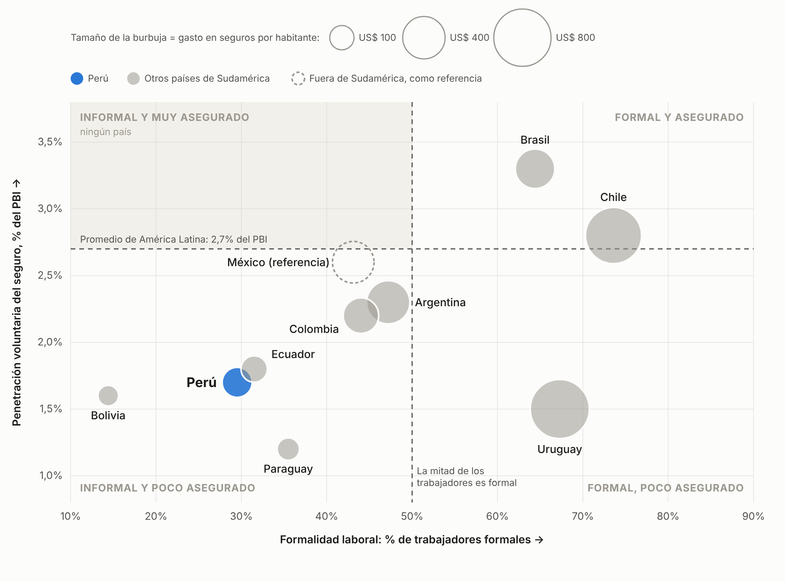
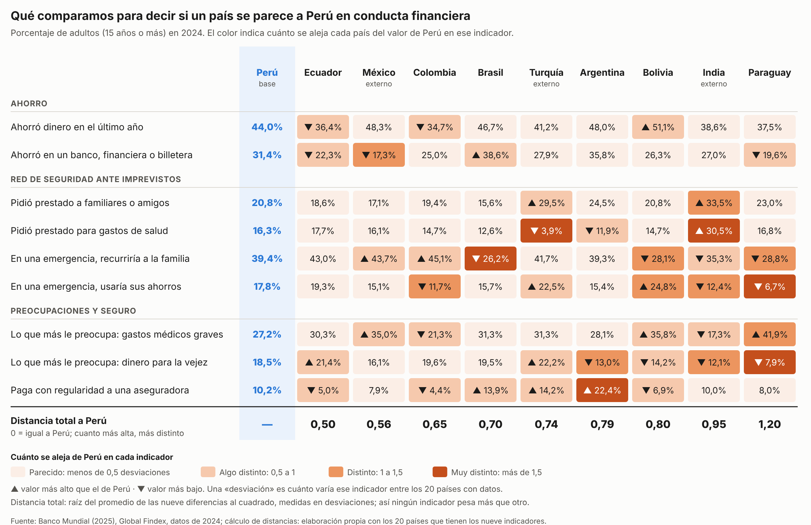

# Digitalización de los seguros en Sudamérica: qué hacen los países que se parecen a Perú y hacia dónde puede ir

Noviembre de 2026 · 18 láminas y anexo

## Hilo de la presentación

1. **Dónde está Perú (láminas 1 a 5).** El estado de la región y tres miradas para comparar países: formalidad y penetración del seguro, digitalización financiera y conducta financiera. Con ellas formamos dos grupos: los países que se parecen a Perú y los que muestran hacia dónde puede ir.
2. **Parte 1: qué hacen las aseguradoras de los países que se parecen a Perú (láminas 6 a 11).** Cinco casos de Colombia, México y Ecuador.
3. **Parte 2: qué hacen las aseguradoras del horizonte (láminas 12 a 17).** Cinco casos de Chile, Brasil y Turquía.
4. **Cierre (lámina 18).** Qué separa a un grupo del otro y tres preguntas para RIMAC.

Cada caso es de una aseguradora, describe una acción concreta en el front o en el back y trae al menos una cifra de resultado publicada, con su fuente.

## Indicaciones generales de diseño

- **Formato:** 16:9. Una idea por lámina: el título es la conclusión, no el tema.
- **Jerarquía:** título de acción (1 línea, máximo 2) → cifras grandes → texto de apoyo breve → fuentes al pie en cuerpo pequeño.
- **Color:** Perú siempre en azul (#2A78D6); el resto de los países en gris (#9A978F o #C9C6BF); fondo claro (#FCFCFB). No usar otros colores para países, para que Perú se encuentre de un vistazo.
- **Tipografía:** sans serif de buena legibilidad. Cifras grandes en negrita (40-48 pt); texto de apoyo en 14-16 pt; fuentes en 10-11 pt.
- **Fuentes:** cada cifra lleva su fuente en el pie de la lámina, en formato (autor, año).

---

## Lámina 1 · Estado de la región

### Título en la lámina

**Sudamérica digitalizó sus pagos en una década; el seguro sigue sin despegar**

### Subtítulo

Seis o siete de cada diez adultos ya tienen una cuenta o hacen pagos digitales; el seguro sigue entre 1% y 3% del PBI y se vende sobre todo por personas.

### Layout sugerido

Tres columnas de igual ancho, cada una con un encabezado y tres cifras grandes con una línea de contexto. Debajo, una franja de ancho completo con la lectura. Pie de lámina con las fuentes.

```
┌─────────────────────────────────────────────────────────────────────────┐
│ TÍTULO DE ACCIÓN                                                        │
│ Subtítulo                                                               │
├───────────────────────┬───────────────────────┬─────────────────────────┤
│ SEGUROS               │ BANCA Y PAGOS         │ TECNOLOGÍA EN SEGUROS   │
│ [cifra] contexto      │ [cifra] contexto      │ [cifra] contexto        │
│ [cifra] contexto      │ [cifra] contexto      │ [cifra] contexto        │
│ [cifra] contexto      │ [cifra] contexto      │ [cifra] contexto        │
├───────────────────────┴───────────────────────┴─────────────────────────┤
│ LECTURA: la brecha entre la billetera y la póliza                       │
└─────────────────────────────────────────────────────────────────────────┘
  Fuentes
```

### Contenido de la lámina

**Columna 1 · Seguros: poco y vendido por personas**

| Cifra grande | Línea de contexto |
|---|---|
| **2,7% del PBI** | Penetración del seguro en América Latina sin las primas de pensiones (3,2% con ellas). En Sudamérica va de 1,2% en Paraguay a 2,8% en Chile; **Perú: 1,7%** |
| **US$ 78 a US$ 853** | Gasto en seguros por habitante, de Paraguay a Uruguay; **Perú: US$ 173** |
| **10% vs 20%** | Ventas de seguros por canales en línea en América Latina frente a Norteamérica y Europa (2021); corredores y agentes venden cerca de 65% |

**Columna 2 · Banca y pagos: el salto digital ya ocurrió**

| Cifra grande | Línea de contexto |
|---|---|
| **70% de los adultos** | Tiene cuenta en América Latina (39% en 2011); **Perú: 59%**. Brasil, Argentina y Chile superan 80% |
| **59% de los adultos** | Hizo o recibió un pago digital en 2024; **Perú: 52%**. El dinero móvil llega a 37% en la región y a **42% en Perú**, por encima del promedio |
| **43% tiene billetera** | En ocho países de la región (11% en 2021): Argentina 77%, Colombia 73%, **Perú 65%**. En Brasil, Pix supera los 160 millones de usuarios |

**Columna 3 · Tecnología en seguros: mucha adopción, poco negocio**

| Cifra grande | Línea de contexto |
|---|---|
| **80% / 84%** | En Brasil, 80% de las aseguradoras usa IA, pero 84% no espera más de 1% de ingresos adicionales por ella |
| **1%** | De las aseguradoras argentinas se define como «digital primero»; 73% de los ejecutivos cree que el seguro dentro de otras apps será relevante en cinco años |
| **67% vs 21%** | De los peruanos prefiere buscar y cotizar seguros en digital frente a los que compran su póliza en línea |

**Franja de lectura (ancho completo)**

> **La brecha está entre la billetera y la póliza.** La región ya paga en digital y Perú está por encima del promedio en dinero móvil, pero el seguro se sigue comprando poco y con una persona de por medio. Los medios de pago que permiten cobrar primas sin tarjeta ya operan en Brasil (Pix Automático) y Colombia (Bre-B), y llegan a Perú en 2027 (TAPP).

### Fuentes al pie

MAPFRE Economics (2025); McKinsey, citado por APESEG (2021); McKinsey (2025); Banco Mundial (2025), Global Findex; Forbes Chile (2026a); Credicorp e Ipsos, Índice de Inclusión Financiera 2025, citado por Forbes Chile (2025); CNseg (2026); EY y CIDeS, citados por iProUP (2026); APESEG (2023); Let's Money (2026); Vodanovic (2026).

### Notas del presentador

- Esta lámina responde «en qué terreno estamos». La idea es mostrar que la digitalización de la banca y los pagos ya pasó, mientras que la del seguro no.
- **Seguros.** Usamos la penetración sin pensiones porque es la que mide la compra voluntaria: con pensiones, Uruguay aparece en 3,6% del PBI; sin ellas, en 1,5%, por debajo de Perú.
- **Banca.** Perú está por debajo de la región en cuentas (59% frente a 70%) y en pagos digitales (52% frente a 59%), pero por encima en dinero móvil (42% frente a 37%): las billeteras le permitieron saltarse la cuenta bancaria tradicional. En el índice de inclusión financiera de Credicorp e Ipsos, Perú tiene 47 puntos, frente a 57,3 de Argentina, 56,7 de Chile, 49 de Ecuador y 45,4 de Colombia.
- **Crédito, si preguntan.** El crédito al sector privado es de cerca de 80% del PBI en Chile, 71% en Brasil, entre 35% y 40% en Perú y Colombia, y 11% en Argentina (Banco Mundial, citado por Forbes Chile, 2026b).
- **Tecnología en seguros.** Brasil y Argentina muestran el mismo patrón desde dos ángulos: mucha IA y muchos proyectos, pero casi nadie puede mostrar ingresos. En Perú, el cliente busca en digital pero compra con una persona.
- **Fuentes de banca.** Las cifras por país vienen directamente de la base del Global Findex 2025 del Banco Mundial; los promedios regionales (70%, 59% y 37%), de la reseña de Forbes Chile sobre el mismo informe. El índice de Credicorp e Ipsos no incluye Brasil, Uruguay ni Paraguay.

### Datos de respaldo por país

| País | Penetración total | Penetración sin pensiones | Gasto por habitante (US$) | Informalidad laboral | Tiene cuenta | Pago digital |
|---|---|---|---|---|---|---|
| Chile | 4,6% | 2,8% | 762 | 26,4% | 85,1% | 84,3%* |
| Uruguay | 3,6% | 1,5% | 853 | 32,7% | 73,7% | 68,0%* |
| Brasil | 3,3% | 3,3% | 338 | 35,6% | 86,4% | 77,4% |
| Colombia | 3,3% | 2,2% | 261 | 56,0% | 57,1% | 49,2% |
| Argentina | 3,0% | 2,3% | 418 | 52,8% | 81,7% | 72,2% |
| **Perú** | **2,0%** | **1,7%** | **173** | **70,5%** | **59,3%** | **51,7%** |
| Ecuador | 1,8% | 1,8% | 124 | 68,5% | 64,5% | 43,3% |
| Bolivia | 1,6% | 1,6% | 63 | 85,6% | 56,8% | 43,6% |
| Paraguay | 1,2% | 1,2% | 78 | 64,5% | 60,9% | 55,5% |
| América Latina | 3,2% | 2,7% | 341 | — | 70% | 59% |
| México (referencia) | 2,7% | 2,6% | 383 | 56,9% | 53,0% | 41,4% |

Fuentes: MAPFRE Economics (2025), datos de 2024; OIT, ILOSTAT (2026), datos de 2025; Banco Mundial (2025), Global Findex, datos de 2024 (* 2021, el último disponible); promedios de América Latina en banca: Forbes Chile (2026a).

---

## Lámina 2 · ¿Dónde está Perú?

### Título en la lámina

**Perú está en el grupo de menor formalidad y menor compra voluntaria de seguros, junto a Ecuador, Paraguay y Bolivia**

### Subtítulo

Formalidad laboral frente a penetración voluntaria del seguro; el tamaño de cada burbuja es el gasto en seguros por habitante.

### Visual

Gráfico de cuadrantes: `cuadrantes.svg` (vector, para editar) o `cuadrantes.png` (imagen, para pegar directo).



- **Eje X:** formalidad laboral, porcentaje de trabajadores formales (100 menos la tasa de informalidad de ILOSTAT).
- **Eje Y:** penetración del seguro sin las primas ligadas a pensiones y riesgos laborales, % del PBI.
- **Tamaño de la burbuja:** gasto en seguros por habitante, en dólares.
- **Líneas de corte:** la mitad de los trabajadores formales (50%) y la penetración voluntaria promedio de América Latina (2,7% del PBI).
- **Color:** Perú en azul; los demás países de Sudamérica en gris; México con contorno punteado, solo como referencia.

### Layout sugerido

Gráfico a la izquierda, ocupando dos tercios del ancho. A la derecha, una columna con «Dónde está Perú» arriba y tres conclusiones numeradas debajo. Fuentes al pie.

```
┌──────────────────────────────────────────────┬──────────────────────────┐
│ TÍTULO DE ACCIÓN                             │                          │
│ Subtítulo                                    │                          │
├──────────────────────────────────────────────┼──────────────────────────┤
│                                              │ DÓNDE ESTÁ PERÚ          │
│         GRÁFICO DE CUADRANTES                │ 30% formal · 1,7% PBI    │
│         (2/3 del ancho)                      │ US$ 173 por habitante    │
│                                              │ 1. ...                   │
│                                              │ 2. ...                   │
│                                              │ 3. ...                   │
└──────────────────────────────────────────────┴──────────────────────────┘
  Fuentes
```

### Contenido de la columna derecha

**Dónde está Perú**

- **29,5%** de trabajadores formales: la segunda formalidad más baja de la región, después de Bolivia.
- **1,7% del PBI** en seguros voluntarios, por debajo del promedio de América Latina (2,7%).
- **US$ 173** por habitante en seguros, la mitad que el promedio regional (US$ 341).

**Tres conclusiones**

1. **Nadie es informal y muy asegurado.** El cuadrante superior izquierdo está vacío: en la región, la informalidad funciona como un techo para la compra voluntaria de seguros.
2. **Ser formal no basta.** Uruguay tiene 67% de formalidad y el mayor gasto por habitante, pero su compra voluntaria (1,5% del PBI) es menor que la de Perú. Solo Brasil y Chile combinan formalidad y compra voluntaria alta.
3. **Los países que más se parecen a Perú son Ecuador, Paraguay, Bolivia y Colombia.** Brasil, Uruguay y Chile son los más distintos, aunque son los que más casos digitales publican.

### Fuentes al pie

OIT, ILOSTAT (2026); MAPFRE Economics (2025), datos de 2024. Cálculo de cuadrantes y de parecido: elaboración propia.

### Notas del presentador

- **Por qué estos ejes.** Son dos indicadores verificados con la misma fuente para todos los países. La formalidad aproxima cuánta gente tiene un ingreso estable, un empleador y una cuenta; la penetración sin pensiones mide cuánto seguro se compra por decisión propia. La digitalización va en la lámina 3.
- **Cambio de fuente.** La informalidad ahora viene de la serie armonizada de ILOSTAT (datos de 2025), en lugar de la nota de Bloomberg Línea con el Panorama Laboral de la OIT. Las dos series difieren (Uruguay, por ejemplo, 32,7% frente a 22,2%) porque miden con definiciones distintas; usamos ILOSTAT porque es la fuente primaria y permite comparar también con Turquía e India. Con ella, Argentina (47% de formalidad) pasa al lado informal del gráfico.
- **Cómo medimos el parecido con Perú.** Estandarizamos tres indicadores (informalidad, penetración sin pensiones y gasto por habitante) entre los diez países y medimos la distancia de cada uno a Perú. De más a menos parecido: Ecuador 0,27; Paraguay 0,94; Bolivia 0,96; Colombia 1,19; Argentina 1,68; México 1,82; Brasil 3,29; Uruguay 3,39; Chile 3,80.
- **Mensaje para cerrar.** Para Perú, los referentes estructurales son Ecuador, Paraguay, Bolivia y Colombia; los referentes de casos digitales son Brasil y Chile. Por eso conviene tomar de Brasil y Chile los mecanismos que se repiten en todas partes, como quitar pasos o resolver el siniestro rápido, y no sus resultados de mercado.

### Datos del gráfico

| País | Formalidad laboral | Penetración sin pensiones | Gasto por habitante (US$) | Cuadrante | Distancia a Perú |
|---|---|---|---|---|---|
| **Perú** | **29,5%** | **1,7%** | **173** | Informal, poco asegurado | — |
| Ecuador | 31,5% | 1,8% | 124 | Informal, poco asegurado | 0,27 |
| Paraguay | 35,5% | 1,2% | 78 | Informal, poco asegurado | 0,94 |
| Bolivia | 14,4% | 1,6% | 63 | Informal, poco asegurado | 0,96 |
| Colombia | 44,0% | 2,2% | 261 | Informal, poco asegurado | 1,19 |
| Argentina | 47,2% | 2,3% | 418 | Informal, poco asegurado | 1,68 |
| México (referencia) | 43,1% | 2,6% | 383 | Informal, poco asegurado | 1,82 |
| Brasil | 64,4% | 3,3% | 338 | Formal y asegurado | 3,29 |
| Uruguay | 67,3% | 1,5% | 853 | Formal, poco asegurado | 3,39 |
| Chile | 73,6% | 2,8% | 762 | Formal y asegurado | 3,80 |

---

## Lámina 3 · Digitalización financiera

### Título en la lámina

**Perú está a mitad de tabla en digitalización financiera: 6 de cada 10 adultos tienen cuenta y 5 de cada 10 pagan en digital**

### Subtítulo

Porcentaje de adultos con una cuenta y que hicieron o recibieron un pago digital en el último año, 2024.

### Visual

Gráfico de barras agrupadas: `digitalizacion.svg` (vector) o `digitalizacion.png` (imagen).


- **Dos barras por país:** gris, tiene una cuenta (banco, financiera o dinero móvil); azul, hizo o recibió un pago digital en el último año.
- **Orden:** de mayor a menor uso de pagos digitales dentro de Sudamérica; debajo, separadas, las referencias de fuera de la región (Turquía, India y México).
- **Perú:** fila resaltada con una banda azul clara y cifras en negrita.

### Layout sugerido

Gráfico a la izquierda, en tres cuartos del ancho. A la derecha, una columna con tres conclusiones. Fuentes al pie.

### Contenido de la columna derecha

**Tres conclusiones**

1. **La región va a dos velocidades.** Chile, Brasil, Argentina y Uruguay tienen 68% o más de adultos con pagos digitales; Perú, Colombia, Bolivia y Ecuador están entre 43% y 52%.
2. **Tener cuenta no es usarla.** En Ecuador, 64,5% tiene cuenta pero solo 43,3% paga en digital; en India, 89,0% frente a 48,5%. En Perú, la brecha es menor: 59,3% frente a 51,7%.
3. **Perú destaca en dinero móvil.** 42,5% de los adultos peruanos tiene una cuenta de dinero móvil, el tercer valor entre los países sudamericanos con dato, después de Brasil (58,2%) y Argentina (56,7%), por encima de Colombia (39,1%) y muy por encima de Ecuador (10,1%).

### Fuentes al pie

Banco Mundial (2025), Global Findex, datos de 2024; Chile y Uruguay, último dato de 2021.

### Notas del presentador

- **Qué mide.** El Global Findex encuesta a adultos de 15 años o más en cada país; «pago digital» incluye pagar o recibir con tarjeta, celular, transferencia o internet.
- **Chile y Uruguay** no tienen dato de pagos digitales en la edición 2025; se muestra el de 2021, marcado con asterisco. Su tenencia de cuenta sí es de 2024.
- **Lectura para el seguro.** El cobro digital de primas tiene una base parecida a la de Colombia o Paraguay: la mitad de los adultos peruanos ya paga en digital y 4 de cada 10 tienen dinero móvil. Lo que falta no es el canal de pago, sino que el seguro se ofrezca y se cobre ahí.
- **Dato relacionado.** El Findex también pregunta si la persona hace pagos regulares a una aseguradora: 10,2% en Perú, frente a 22,4% en Argentina, 13,9% en Brasil, 5,0% en Ecuador y 4,4% en Colombia.

### Datos del gráfico

| País | Tiene cuenta | Pago digital | Dinero móvil | Paga a una aseguradora |
|---|---|---|---|---|
| Chile | 85,1% | 84,3%* | s. d. | s. d. |
| Brasil | 86,4% | 77,4% | 58,2% | 13,9% |
| Argentina | 81,7% | 72,2% | 56,7% | 22,4% |
| Uruguay | 73,7% | 68,0%* | s. d. | s. d. |
| Paraguay | 60,9% | 55,5% | 35,9% | 8,0% |
| **Perú** | **59,3%** | **51,7%** | **42,5%** | **10,2%** |
| Colombia | 57,1% | 49,2% | 39,1% | 4,4% |
| Bolivia | 56,8% | 43,6% | 20,0% | 6,9% |
| Ecuador | 64,5% | 43,3% | 10,1% | 5,0% |
| Turquía (referencia) | 81,6% | 71,4% | 23,3% | 14,2% |
| India (referencia) | 89,0% | 48,5% | 23,1% | 10,0% |
| México (referencia) | 53,0% | 41,4% | 10,4% | 7,9% |

Fuente: Banco Mundial (2025), Global Findex, datos de 2024 (* 2021). s. d.: sin dato en la edición 2025.

---

## Lámina 4 · Conducta financiera

### Título en la lámina

**En hábitos financieros, Ecuador, México y Colombia son los más parecidos a Perú; Turquía está más cerca que Bolivia o Paraguay**

### Subtítulo

Nueve hábitos de ahorro, de respuesta ante imprevistos y de preocupación por el futuro, comparados con Perú. Porcentaje de adultos, 2024.

### Visual

Matriz: `matriz-conducta.svg` (vector) o `matriz-conducta.png` (imagen).



- **Filas:** los nueve indicadores del Global Findex, en tres grupos: ahorro, red de seguridad ante imprevistos, y preocupaciones y seguro.
- **Columnas:** Perú como base (columna azul) y los demás países, de más a menos parecidos.
- **Celdas:** el valor de cada país. El color dice cuánto se aleja de Perú en ese indicador (de claro, parecido, a oscuro, muy distinto) y la flecha, si está por encima o por debajo.
- **Última fila:** la distancia total, que resume las nueve diferencias en un solo número.

### Layout sugerido

La matriz ocupa todo el ancho; el título y el subtítulo van arriba y una franja de lectura de una línea abajo, sobre las fuentes.

### Franja de lectura

> **Parecerse en conducta no es parecerse en estructura.** México y Turquía se comportan como Perú con el dinero, pero tienen más formalidad o más penetración de seguros. Paraguay, que se parece mucho en estructura, es el más distinto en conducta (Banco Mundial, 2025; cálculo propio).

### Fuentes al pie

Banco Mundial (2025), Global Findex, datos de 2024. Cálculo de distancias: elaboración propia con los 20 países que tienen los nueve indicadores.

### Notas del presentador

- **Cómo se calcula, en tres pasos.**
  1. Tomamos los nueve indicadores para los 20 países que tienen todos los datos de 2024.
  2. Medimos cada diferencia con Perú en «desviaciones»: cuánto se separa el país de Perú, dividido por cuánto varía ese indicador entre los 20 países.
  3. Resumimos las nueve diferencias con la raíz del promedio de los cuadrados. Cero es igual a Perú; cuanto más alto, más distinto. Ningún indicador pesa más que otro.
- **Turquía** se parece en cuánto recurre a la familia en una emergencia (41,7% frente a 39,4%) y en lo que le preocupa, pero casi nadie pide prestado para salud (3,9% frente a 16,3%).
- **India** se aleja en la red de seguridad: pide mucho más prestado a familiares (33,5%) y para salud (30,5%). Paga seguros en la misma proporción que Perú (10,0%).
- **Chile y Uruguay** no tienen estos indicadores para 2024, así que no entran en la matriz.
- **Límite:** son hábitos financieros declarados en una encuesta, no rasgos culturales.

### Los nueve indicadores (respaldo)

| Tema | Indicador (pregunta del Findex) | Código | Por qué importa para el seguro | Perú |
|---|---|---|---|---|
| Ahorro | Ahorró dinero en el último año | save.any.t.d | Capacidad de apartar dinero para pagar una prima | 44,0% |
| Ahorro | Ahorró en un banco, financiera o billetera | fin17a.17a1.d | Hábito de usar el sistema formal para protegerse | 31,4% |
| Red de seguridad | Pidió prestado a familiares o amigos | fin22b | Peso de la familia como «seguro informal» | 20,8% |
| Red de seguridad | Pidió prestado para gastos de salud | fin22d | Riesgo de salud que hoy se cubre con deuda | 16,3% |
| Red de seguridad | En una emergencia, recurriría a la familia | fin24fam | Con qué compite el seguro: la familia como primer recurso | 39,4% |
| Red de seguridad | En una emergencia, usaría sus ahorros | fin24sav | Autoprotección con recursos propios | 17,8% |
| Preocupaciones y seguro | Lo que más le preocupa: gastos médicos graves | fin45c | Necesidad sentida de protección en salud | 27,2% |
| Preocupaciones y seguro | Lo que más le preocupa: dinero para la vejez | fin45a | Necesidad sentida de ahorro y vida | 18,5% |
| Preocupaciones y seguro | Paga con regularidad a una aseguradora | fin19 | Hábito actual de pagar un seguro | 10,2% |

---

## Lámina 5 · Dos grupos de referencia

### Título en la lámina

**Dos grupos para mirar: cinco países que se parecen a Perú hoy y cuatro que muestran hacia dónde puede ir**

### Subtítulo

Agrupamos a los países con las tres miradas de las láminas anteriores: formalidad y penetración del seguro, conducta financiera y digitalización.

### Layout sugerido

Dos bloques lado a lado, cada uno con su regla de entrada arriba y la lista de países con sus cifras debajo. Perú en una franja central, como referencia. Argentina en una nota al pie, fuera de los dos grupos.

```
┌─────────────────────────────────────────────────────────────────────────┐
│ TÍTULO DE ACCIÓN                                                        │
├──────────────────────────────┬──────────┬───────────────────────────────┤
│ SE PARECEN A PERÚ            │  PERÚ    │ HORIZONTE                     │
│ Regla de entrada             │ 29,5%    │ Regla de entrada              │
│ Ecuador · Colombia · Bolivia │ 1,7%     │ Chile · Brasil · Uruguay ·    │
│ Paraguay · México            │ 51,7%    │ Turquía                       │
│ (tabla corta)                │          │ (tabla corta)                 │
└──────────────────────────────┴──────────┴───────────────────────────────┘
  Nota sobre Argentina · Fuentes
```

### Reglas de entrada

- **Se parecen a Perú:** más de la mitad de los trabajadores en la informalidad, penetración voluntaria del seguro por debajo del promedio de América Latina (2,7% del PBI) y entre 41% y 56% de adultos con pagos digitales. Perú: 70,5% de informalidad, 1,7% del PBI y 51,7% de pagos digitales.
- **Horizonte:** más de 60% de trabajadores formales y más de dos tercios de los adultos con pagos digitales.

### Datos de la lámina

| País | Grupo | Formalidad laboral | Penetración sin pensiones | Pago digital | Distancia estructural a Perú | Distancia de conducta a Perú |
|---|---|---|---|---|---|---|
| Ecuador | Se parece | 31,5% | 1,8% | 43,3% | 0,27 | 0,50 |
| Paraguay | Se parece | 35,5% | 1,2% | 55,5% | 0,94 | 1,20 |
| Bolivia | Se parece | 14,4% | 1,6% | 43,6% | 0,96 | 0,80 |
| Colombia | Se parece | 44,0% | 2,2% | 49,2% | 1,19 | 0,65 |
| México | Se parece | 43,1% | 2,6% | 41,4% | 1,82 | 0,56 |
| **Perú** | — | **29,5%** | **1,7%** | **51,7%** | — | — |
| Brasil | Horizonte | 64,4% | 3,3% | 77,4% | 3,29 | 0,70 |
| Uruguay | Horizonte | 67,3% | 1,5% | 68,0%* | 3,39 | s. d. |
| Chile | Horizonte | 73,6% | 2,8% | 84,3%* | 3,80 | s. d. |
| Turquía | Horizonte | 73,4% | 2,8%** | 71,4% | s. d. | 0,74 |

\* Dato de 2021, el último disponible. \*\* Penetración total, de otra fuente; no es comparable con la de MAPFRE sin pensiones. s. d.: sin dato.

### Nota al pie sobre Argentina

Argentina no entra en ninguno de los dos grupos: es informal como Perú (47,2% de formalidad), pero paga en digital como el horizonte (72,2%). Además, fue el único mercado de la región cuyas primas cayeron en términos reales en 2024, −13,1% (Infomercado, 2025b).

### Fuentes al pie

OIT, ILOSTAT (2026), datos de 2025; MAPFRE Economics (2025), datos de 2024; Banco Mundial (2025), Global Findex, datos de 2024; Allianz Research, citado por Allianz Türkiye (2025). Grupos y distancias: elaboración propia.

### Notas del presentador

- **Por qué México entra en «se parecen».** Es el segundo país más parecido en conducta (0,56) y cumple las tres reglas: 56,9% de informalidad, 2,6% de penetración y 41,4% de pagos digitales.
- **Por qué Turquía entra en el horizonte.** Se parece a Perú en conducta financiera (0,74), pero tiene 73% de formalidad y 71% de pagos digitales. Muestra cómo se ve un mercado más formal y más digital con hábitos parecidos a los peruanos.
- **Uruguay es un horizonte a medias.** Es formal y digital, pero su compra voluntaria de seguros (1,5% del PBI) es menor que la de Perú. Además, no encontramos ninguna aseguradora uruguaya que publique resultados de sus iniciativas digitales; por eso no tiene un caso en la parte 2.
- **Bolivia y Paraguay** tampoco tienen casos con resultados publicados; los cinco casos de la parte 1 son de Colombia, México y Ecuador.

---

# Parte 1 · Lo que hacen las aseguradoras de los países que se parecen a Perú

## Lámina 6 · Resumen de la parte 1

### Título en la lámina

**En los países parecidos a Perú, las aseguradoras capturan valor de dos formas: venden dentro de apps ajenas y sacan a las personas de los trámites simples**

### Subtítulo

Cinco aseguradoras de Colombia, México y Ecuador con una acción concreta y un resultado publicado.

### Layout sugerido

Tabla de cinco filas a todo el ancho. Una columna con un ícono de front o de back. Debajo, una franja con el patrón común.

### Contenido de la lámina

| Aseguradora | País | Qué hace | Dónde | Resultado publicado |
|---|---|---|---|---|
| Seguros Mundial | Colombia | Vende el SOAT y otros seguros dentro de Nequi, Rappi, Puntos Colombia y Mercado Libre | Front: venta en ecosistemas | **Más de 1,8 millones de pólizas** emitidas con aliados tecnológicos |
| Aseguradora Solidaria | Colombia | Abre más de 300 APIs para que bancos, cooperativas y plataformas vendan sus seguros | Front y back: venta en ecosistemas | **Primas +6,6%**, frente a 5,95% del mercado |
| Quálitas | México | El cliente reporta un choque menor con fotos desde el celular, sin ajustador en el lugar | Front y back: siniestros | **28% de los siniestros** de 2024 se atendieron así |
| Seguros SURA | México | La IA recibe y clasifica los pedidos de agentes e intermediarios | Back: operación | Respuesta de **20 horas a 8 minutos** |
| Seguros Alianza | Ecuador | Asistente en WhatsApp para reportar siniestros, consultar su estado y comprar | Front: servicio | **26%** de las atenciones, frente al teléfono |

### Franja de patrón común

> **Lectura nuestra:** en estos mercados el valor no viene de una app propia con muchos usuarios. Viene de dos lados: de vender en el tráfico de otros (billeteras, apps de delivery, bancos y cooperativas) y de sacar a las personas de los trámites simples (choques menores, pedidos de intermediarios, consultas). Ninguna de las cinco publica cuánto invirtió ni cuánto le devolvió.

### Fuentes al pie

Semana (2026); ABC Economía (2026); Quálitas (2025); Darío Celis (2026); KCH FM (2026).

### Notas del presentador

- **Criterio de selección.** Solo aseguradoras (no billeteras ni bancos), con una acción concreta y al menos una cifra de resultado publicada desde 2024. Todas las cifras las declara la propia empresa, en su informe anual o en la prensa.
- **Bolivia y Paraguay.** No encontramos aseguradoras con resultados digitales publicados. En Paraguay, El Sol de Seguros dijo en 2018 que su plataforma para agentes bajó trámites de 24 horas a 15 minutos (Infonegocios, 2018), pero el dato es viejo y no tiene seguimiento. En Bolivia, Nacional Seguros habla de «digitalizar procesos», sin cifras (Eju, s. f.).
- **Un ajuste a una cifra anterior.** En el informe y en la presentación al CEO decíamos que Seguros Mundial vendió «1,8 millones de SOAT en 2025». La fuente original dice algo más amplio: más de 1,8 millones de pólizas emitidas con aliados tecnológicos, de SOAT y otros seguros, sin precisar el período (Semana, 2026).

---

## Lámina 7 · Caso Seguros Mundial (Colombia)

### Título en la lámina

**Seguros Mundial vende el SOAT dentro de las apps que el colombiano ya usa y suma más de 1,8 millones de pólizas por esa vía**

### Ficha

- **País:** Colombia. Distancia de conducta a Perú: 0,65; estructural: 1,19.
- **Dónde actúa:** front, venta en ecosistemas digitales de terceros.
- **Aliados:** Nequi (billetera de Bancolombia), Rappi (delivery), Puntos Colombia (programa de puntos) y Mercado Libre.

### Qué hace

- Emite el SOAT y otras pólizas dentro de las apps de sus aliados: el cliente compra sin salir de la app que ya tiene abierta.
- Mantiene el liderazgo en SOAT apoyada en esos aliados, según la propia compañía.

### Cifras de impacto

| Cifra grande | Qué mide |
|---|---|
| **Más de 1,8 millones** | Pólizas emitidas mediante aliados tecnológicos, de SOAT y otros seguros |
| **+21%** | Crecimiento en seguros generales sin contar el SOAT, en el último año informado |
| **Más de $1,4 billones** | Pagos de siniestros entre 2025 y lo que va de 2026 (pesos colombianos) |

### Cómo captura valor

**Ingresos:** volumen de pólizas a bajo costo de adquisición, porque el tráfico lo pone el aliado.

### Qué nos dice para RIMAC

> **Lectura nuestra:** el SOAT es la puerta de entrada más simple en un país informal, porque es obligatorio y no hay que convencer a nadie. En Perú el equivalente sería venderlo donde el cliente ya paga (billeteras y apps de pago). El riesgo es que el cliente queda del lado del aliado: en RIMAC, los clientes que llegan por socios son los menos digitales (21,2%) (RIMAC, 2026e).

### Fuentes al pie

Semana (2026); RIMAC (2026e), uso interno.

### Notas del presentador

- La fuente no separa cuántas de las 1,8 millones de pólizas son SOAT ni de qué período son. Es un dato declarado por la empresa.
- El 21% de crecimiento excluye el SOAT, así que no se puede atribuir a la venta en apps.

---

## Lámina 8 · Caso Aseguradora Solidaria (Colombia)

### Título en la lámina

**Aseguradora Solidaria abrió más de 300 APIs para que otros vendan sus seguros, y sus primas crecen por encima del mercado**

### Ficha

- **País:** Colombia. Distancia de conducta a Perú: 0,65; estructural: 1,19.
- **Dónde actúa:** front y back. Las APIs son la infraestructura (back) que permite vender en canales de terceros (front).
- **Canales:** bancos, cooperativas y plataformas digitales que integran los seguros en su propia experiencia.

### Qué hace

- Pone a disposición más de 300 APIs, para que un banco, una cooperativa o una plataforma integre y venda sus seguros dentro de su propio canal.
- La aseguradora no necesita una red propia en cada punto: el socio pone el cliente y la aseguradora, el producto.

### Cifras de impacto

| Cifra grande | Qué mide |
|---|---|
| **Más de 300** | APIs disponibles para aliados |
| **+6,6% frente a +5,95%** | Crecimiento de sus primas frente al del mercado (datos de Fasecolda) |

### Cómo captura valor

**Ingresos:** crecimiento por encima del mercado, con costo de distribución variable.

### Qué nos dice para RIMAC

> **Lectura nuestra:** el modelo de Solidaria es la versión «industrial» del de Seguros Mundial: en lugar de negociar cada alianza a medida, ofrece piezas estándar que cualquier socio conecta. RIMAC ya tiene más de 20 alianzas de bancaseguros y coloca cerca de 30.000 seguros al mes con el Grupo EFE (Revista Economía, 2026); la pregunta es cuánto cuesta sumar el socio número 21.

### Fuentes al pie

ABC Economía (2026), con datos de Fasecolda; Revista Economía (2026).

### Notas del presentador

- La fuente no atribuye todo el crecimiento a las APIs; muestra que la compañía crece por encima del mercado mientras abre ese canal.
- Esta fuente la verificamos en noviembre de 2026; hoy no pudimos volver a abrirla porque la red del entorno bloquea el sitio.

---

## Lámina 9 · Caso Quálitas (México)

### Título en la lámina

**Quálitas atendió 28% de sus siniestros de 2024 con fotos desde el celular, sin enviar un ajustador**

### Ficha

- **País:** México. Distancia de conducta a Perú: 0,56, el segundo más parecido.
- **Dónde actúa:** front (el cliente reporta y envía fotos) y back (el ajuste se hace a distancia).
- **Tecnología:** «Ajuste Exprés Digital», al que se entra por su app Q Móvil, por teléfono o por su asistente Qualibot.

### Qué hace

- En siniestros menores, el cliente toma fotos y da los datos del choque; no hace falta que un ajustador vaya al lugar.
- Mantiene ajustadores presenciales para los casos complejos y para camiones y tráileres, con una red de más de 200.

### Cifras de impacto

| Cifra grande | Qué mide |
|---|---|
| **28%** | De todos los siniestros atendidos en México en 2024 pasaron por el Ajuste Exprés Digital |
| **94,1%** | Satisfacción del cliente con el Ajuste Exprés Digital en 2024 (95,8% con el ajustador presencial) |
| **53%** | De los vehículos robados que tenían dispositivo de localización fueron recuperados |

### Cómo captura valor

**Costo y tiempo:** cada siniestro que no requiere ajustador en el lugar ahorra un traslado. La satisfacción casi no cae frente al proceso presencial.

### Qué nos dice para RIMAC

> **Lectura nuestra:** en RIMAC, reportar un choque es digital solo en 2,0% de los casos (RIMAC, 2026b), y el agente de IA ya analiza un siniestro vehicular en 60 segundos (Infomercado, 2025). Quálitas muestra que el cuello de botella puede estar en la entrada del aviso, no en el análisis: el autoajuste con fotos funciona para el choque menor.

### Fuentes al pie

Quálitas (2025), *Integrated Annual Report 2024*; RIMAC (2026b), uso interno; Infomercado (2025).

### Notas del presentador

- Quálitas es líder del seguro de autos en México desde 2001, según su propio informe. El dato viene de su informe anual integrado, que también reporta los indicadores de satisfacción por proceso.
- El informe no publica el costo por siniestro con y sin ajustador; el ahorro es una inferencia.

---

## Lámina 10 · Caso Seguros SURA (México)

### Título en la lámina

**Seguros SURA México responde a sus intermediarios en 8 minutos en lugar de 20 horas con IA que lee y clasifica sus pedidos**

### Ficha

- **País:** México. Distancia de conducta a Perú: 0,56.
- **Dónde actúa:** back, en la operación con agentes e intermediarios.
- **Tecnología:** IA que recibe, lee y clasifica los correos de cotización, emisión y renovación; también se usa en el ingreso hospitalario.

### Qué hace

- Los agentes envían sus pedidos por correo, como siempre; la IA los ordena y los deriva sin que nadie tenga que leerlos uno por uno.
- En salud, la IA valida diagnósticos y tratamientos en el ingreso hospitalario y señala posibles fraudes.

### Cifras de impacto

| Cifra grande | Qué mide |
|---|---|
| **De 20 horas a 8 minutos** | Tiempo promedio de atención de los pedidos de agentes e intermediarios |
| **58.500 correos** | Procesados entre marzo y julio de 2026 |
| **85%** | Efectividad en la recepción y clasificación de pedidos |
| **Hasta 30% menos** | Tiempo de resolución de siniestros |

### Cómo captura valor

**Costo y tiempo:** menos horas de trabajo manual por pedido. Lectura nuestra: el corredor que recibe respuesta en minutos puede cerrar antes la venta, aunque la nota no lo mide.

### Qué nos dice para RIMAC

> **Lectura nuestra:** corredores y agentes venden cerca de 65% de los seguros en América Latina (McKinsey, citado por APESEG, 2021), y en RIMAC el canal de corredores suma 883 mil registros de clientes (RIMAC, 2026e). Este caso no pide al corredor que cambie su forma de trabajar: la IA se pone detrás del correo que ya usa. Es una mejora de back office que el cliente final no ve, pero que acelera la venta.

### Fuentes al pie

Darío Celis (2026); McKinsey, citado por APESEG (2021); RIMAC (2026e), uso interno.

### Notas del presentador

- Las cifras son declaradas por la empresa (Marco Guerrero, director de tecnología de Seguros SURA) en una nota publicada el 27 de agosto de 2026.
- La nota no dice cuánto aumentaron las ventas de los intermediarios; ese efecto es una hipótesis nuestra.

---

## Lámina 11 · Caso Seguros Alianza (Ecuador)

### Título en la lámina

**En Ecuador, el país más parecido a Perú, Seguros Alianza ya atiende por WhatsApp una de cada cuatro consultas, y apunta a más de un tercio en 2026**

### Ficha

- **País:** Ecuador. El más parecido a Perú en estructura (0,27) y en conducta (0,50).
- **Dónde actúa:** front, servicio y siniestros.
- **Tecnología:** «Ali», asistente virtual en WhatsApp Business, disponible las 24 horas, con traspaso inmediato a una persona.

### Qué hace

- Por WhatsApp, el cliente pide asistencia, reporta un siniestro y consulta su estado, compra un seguro, gestiona su póliza o presenta un reclamo.
- El mismo canal lo usan los corredores, los talleres y los proveedores.
- Lo simple lo responde «Ali»; lo que requiere análisis pasa de inmediato a un asesor.

### Cifras de impacto

| Cifra grande | Qué mide |
|---|---|
| **26%** | Atenciones por WhatsApp en 2025, frente al canal telefónico (3.196 interacciones) |
| **36%** | Meta de atenciones por WhatsApp en 2026 |

### Cómo captura valor

**Costo de servir:** cada consulta que pasa del teléfono a WhatsApp, y en especial las que «Ali» resuelve sin una persona, cuesta menos. Es un caso en etapa temprana: todavía no hay cifras de ahorro.

### Qué nos dice para RIMAC

> **Lectura nuestra:** es el caso más pequeño de los cinco, pero viene del país más parecido a Perú. Muestra que en un mercado informal la migración al canal digital empieza por WhatsApp, no por la app, y que avanza de a pocos: la meta es pasar de 26% a 36% en un año.

### Fuentes al pie

KCH FM (2026), comunicado de Seguros Alianza.

### Notas del presentador

- Las 3.196 interacciones son un volumen bajo; la cifra relevante es la proporción frente al teléfono.
- El 36% es una meta, no un resultado.

---

# Parte 2 · Lo que hacen las aseguradoras de los países que muestran el horizonte

## Lámina 12 · Resumen de la parte 2

### Título en la lámina

**En el horizonte, la tecnología ya mueve cifras de escala: millones de pólizas, siniestros que se pagan en días y un retorno medido en euros**

### Subtítulo

Cinco aseguradoras de Brasil, Chile y Turquía con una acción concreta y un resultado publicado.

### Layout sugerido

Igual que la lámina 6: tabla de cinco filas y franja de patrón común.

### Contenido de la lámina

| Aseguradora | País | Qué hace | Dónde | Resultado publicado |
|---|---|---|---|---|
| Southbridge | Chile | Vende el SOAP por su canal digital | Front: venta directa | **Más de 1,3 millones** de SOAP en 2024: **25%** del parque automotor |
| Porto | Brasil | Un agente de IA en WhatsApp abre los avisos de robo de autos | Front y back: siniestros | **70%** de esos avisos automatizados; **−29%** de contactos por siniestro |
| Tokio Marine | Brasil | Paga la pérdida total y el robo consultando documentos en línea | Back: pago de siniestros | **−60%** de tiempo de pago; cotización de transporte de 10 minutos a **30 segundos** |
| Bradesco Seguros | Brasil | IA más especialistas atienden a los corredores por WhatsApp | Back: soporte al corredor | De 135 a **más de 1.200** corredores; producción **hasta 3 veces** mayor en algunas sucursales |
| Allianz Türkiye | Turquía | IA en siniestros, cotización, documentos y fraude | Back: operación | **€15 millones** invertidos y **más de €20 millones** de valor generado |

### Franja de patrón común

> **Lectura nuestra:** en el horizonte, la IA se aplica en el siniestro y en el corredor, y lo complementa en lugar de reemplazarlo. La diferencia con la parte 1 es de escala y de medición: aquí las cifras son de millones de pólizas, de días de pago y, en Turquía, de retorno de la inversión.

### Fuentes al pie

Diario Financiero (2025); Revista Apólice (2026); CQCS (2024, 2026a, 2026b); TI Inside (2026); Allianz Türkiye (2026).

### Notas del presentador

- **Mismo criterio que en la parte 1:** aseguradoras, una acción concreta y una cifra publicada desde 2024; todas son cifras declaradas por la empresa.
- **Uruguay.** No encontramos aseguradoras uruguayas que publiquen resultados de sus iniciativas digitales.
- **Por qué tres casos de Brasil.** Es el país del horizonte que más resultados publica. Elegimos tres casos que actúan en lugares distintos de la cadena: el aviso del siniestro (Porto), el pago (Tokio Marine) y el corredor (Bradesco).

---

## Lámina 13 · Caso Southbridge (Chile)

### Título en la lámina

**Southbridge se quedó con un cuarto del SOAP chileno gracias a su canal digital: más de 1,3 millones de pólizas en 2024**

### Ficha

- **País:** Chile. Horizonte: 73,6% de formalidad y 84,3% de pagos digitales.
- **Dónde actúa:** front, venta digital directa de un seguro obligatorio.
- **Contexto:** en Chile, el SOAP se exige para renovar el permiso de circulación, y la venta se concentra en febrero y marzo.

### Qué hace

- Apostó por su canal digital para vender el SOAP; la compañía lo señala como un factor clave de su crecimiento.
- Suma un componente solidario: el cliente puede donar a Bomberos al contratar.

### Cifras de impacto

| Cifra grande | Qué mide |
|---|---|
| **Más de 1,3 millones** | Pólizas de SOAP vendidas en 2024 |
| **25%** | Del parque automotor chileno |

### Cómo captura valor

**Ingresos y clientes:** cuota de mercado en un producto obligatorio y una base de más de un millón de clientes con quienes tiene contacto cada año.

### Qué nos dice para RIMAC

> **Lectura nuestra:** es el mismo producto que el caso de Seguros Mundial, en otra etapa. En Colombia el SOAT se vende en apps de terceros; en Chile, una aseguradora lo vende directo y en digital a escala. En RIMAC, solo 44,7% de los clientes de SOAT es digital (RIMAC, 2026e).

### Fuentes al pie

Diario Financiero (2025); RIMAC (2026e), uso interno.

### Notas del presentador

- La ejecutiva de Southbridge atribuye el crecimiento al canal digital («factor clave»), pero la nota no separa cuántas pólizas se vendieron en digital.
- La fuente es de febrero de 2025; los datos son de 2024.

---

## Lámina 14 · Caso Porto (Brasil)

### Título en la lámina

**Porto abre por WhatsApp, con un agente de IA, 7 de cada 10 avisos de robo de autos, y redujo 29% los contactos por siniestro**

### Ficha

- **País:** Brasil. Horizonte: 64,4% de formalidad y 77,4% de pagos digitales; en conducta, 0,70 de distancia a Perú.
- **Dónde actúa:** front (aviso por WhatsApp) y back (análisis con IA).
- **Tecnología:** agente conversacional de IA generativa en WhatsApp; el cliente puede pasar a una persona cuando quiera.

### Qué hace

- El cliente avisa del robo o hurto de su auto por WhatsApp y el agente de IA abre el siniestro.
- Rediseñó todo el recorrido digital del siniestro de auto: aviso, seguimiento de la reparación en tiempo real y elección del taller según la calificación de otros clientes y corredores.

### Cifras de impacto

| Cifra grande | Qué mide |
|---|---|
| **70%** | De los avisos de robo y hurto de vehículos se abren de forma automática |
| **Más de 80%** | Satisfacción con el agente en los primeros meses |
| **−29%** | Contactos relacionados con siniestros tras rediseñar el recorrido digital |

### Cómo captura valor

**Costo de servir y experiencia:** menos llamadas por siniestro, con satisfacción alta.

### Qué nos dice para RIMAC

> **Lectura nuestra:** Porto empezó por un tipo de siniestro acotado (robo y hurto) y por el canal que el cliente ya usa (WhatsApp). En RIMAC, el choque se reporta en digital en 2,0% de los casos, y 55% de las gestiones de siniestro todavía pasa por el centro de contacto (RIMAC, 2026b).

### Fuentes al pie

Revista Apólice (2026); CQCS (2026a); RIMAC (2026b), uso interno.

### Notas del presentador

- El 70% se refiere solo a los avisos de robo y hurto, no a todos los siniestros; algunas notas lo generalizan por error.
- La siniestralidad de Porto no mejoró en 2025, así que el valor publicado está en el costo de servir y la experiencia, no en el costo de los siniestros.

---

## Lámina 15 · Caso Tokio Marine (Brasil)

### Título en la lámina

**Tokio Marine Brasil redujo 60% el tiempo de pago de la pérdida total y el robo al consultar los documentos en línea en lugar de esperarlos en papel**

### Ficha

- **País:** Brasil. Horizonte.
- **Dónde actúa:** back, pago de siniestros y cotización.
- **Tecnología:** «Projeto 72h», que consulta en línea la mayoría de los documentos con el número de identificación del cliente, e IA generativa en la cotización.

### Qué hace

- En pérdida total, robo o hurto de autos, el cliente abre el siniestro en la app o en la web y envía solo dos documentos; la mayoría de los demás los consulta la aseguradora con el número de identificación del cliente. Antes, el proceso esperaba al menos 5 días a que llegaran los papeles.
- En el seguro de transporte por embarque, la IA generativa arma la cotización para el corredor.

### Cifras de impacto

| Cifra grande | Qué mide |
|---|---|
| **−60%** | Tiempo promedio de pago en pérdida total, robo o hurto, en tres meses |
| **3 días** | Meta de pago |
| **De 10 minutos a 30 segundos** | Tiempo de cotización del seguro de transporte (−95%) |

### Cómo captura valor

**Experiencia en el momento de verdad y productividad del corredor:** el cliente recibe la indemnización antes y el corredor cotiza en segundos.

### Qué nos dice para RIMAC

> **Lectura nuestra:** el mayor ahorro de tiempo no vino de una app, sino de dejar de pedir papeles. Sería útil revisar qué documentos pide hoy RIMAC en una pérdida total que ya podría consultar en fuentes públicas, como SUNARP o RENIEC.

### Fuentes al pie

CQCS (2024); TI Inside (2026).

### Notas del presentador

- El −60% es de los tres meses previos a julio de 2024. A fines de 2025, Tokio Marine informó una baja adicional de 9% en el plazo de pago de siniestros, con NPS de siniestros de 81 (Legismap, 2026).

---

## Lámina 16 · Caso Bradesco Seguros (Brasil)

### Título en la lámina

**Bradesco Seguros atiende a más de 1.200 corredores con IA y especialistas por WhatsApp; en algunas sucursales, los corredores triplicaron su producción**

### Ficha

- **País:** Brasil. Horizonte.
- **Dónde actúa:** back, soporte comercial y operativo al corredor.
- **Tecnología:** «Conecta», desarrollado con la insurtech Segura: agentes de IA supervisados por especialistas, integrados a WhatsApp.

### Qué hace

- El corredor escribe por WhatsApp para cotizar, consultar la suscripción, negociar o resolver una duda operativa; la IA responde y un especialista supervisa.
- También le señala oportunidades en su cartera: renovaciones, cotizaciones abiertas y posibilidades de ampliar el negocio.

### Cifras de impacto

| Cifra grande | Qué mide |
|---|---|
| **De 135 a más de 1.200** | Corredores atendidos, del piloto a la expansión desde marzo de 2026 |
| **98,61%** | De los cerca de 3.400 pedidos de mayo los resolvió la operación de IA con especialistas |
| **Hasta 3 veces** | Aumento de producción de los corredores participantes en algunas sucursales |

### Cómo captura valor

**Ingresos a través del corredor:** más corredores activos y más producción por corredor, con el mismo equipo de soporte.

### Qué nos dice para RIMAC

> **Lectura nuestra:** en una encuesta de Segura a más de 2.700 corredores, más de 75% dijo que su principal dificultad es el soporte de la aseguradora, por delante del precio y el producto (CQCS, 2026b). Si eso se repite en Perú, la tecnología para el corredor podría rendir más que la tecnología para el cliente final.

### Fuentes al pie

CQCS (2026b).

### Notas del presentador

- El «hasta 3 veces» se refiere a algunas sucursales y a un período acotado; no es un promedio.
- Bradesco Seguros sostiene que «los corredores siempre serán el principal canal» del grupo.

---

## Lámina 17 · Caso Allianz Türkiye (Turquía)

### Título en la lámina

**Allianz Türkiye invirtió €15 millones en datos e IA en cinco años y declara más de €20 millones de valor generado**

### Ficha

- **País:** Turquía. Horizonte: 73% de formalidad y 71% de pagos digitales, con conducta financiera parecida a la peruana (0,74).
- **Dónde actúa:** back, en siniestros, cotización comercial, documentos y fraude.
- **Tecnología:** datos y analítica desde 2018; IA generativa y agentes de IA.

### Qué hace

- Usa IA para decidir siniestros, preparar cotizaciones comerciales, procesar documentos y detectar fraude.
- Mide cada modelo por su resultado de negocio, no por su precisión técnica.

### Cifras de impacto

| Cifra grande | Qué mide |
|---|---|
| **€15 millones → más de €20 millones** | Inversión en datos e IA en cinco años y valor de negocio medible declarado |
| **5 veces** | Más rápidas las decisiones de siniestros |
| **De 4 horas a 15 minutos** | Preparación de una cotización comercial |
| **99%** | Precisión en el procesamiento de documentos |
| **+30%** | Tasa de éxito en la detección de fraude |

### Cómo captura valor

**Retorno medido:** es el único caso de los diez que publica cuánto invirtió y cuánto le devolvió.

### Qué nos dice para RIMAC

> **Lectura nuestra:** el caso no es interesante por la tecnología, sino por la forma de medir. Allianz Türkiye mide la IA en euros de valor de negocio, no en cantidad de modelos o de usuarios. Es el estándar que permitiría comparar iniciativas digitales entre sí.

### Fuentes al pie

Allianz Türkiye (2026).

### Notas del presentador

- Las cifras son de la propia empresa y no detallan cómo se calcula el «valor de negocio».
- En otra nota, Allianz Türkiye informa que aprueba con IA más de 90% de 13 a 15 millones de pedidos de autorización al año, sobre todo de salud (Sigorta Kulisi, 2026).

---

## Lámina 18 · Cierre

### Título en la lámina

**De los parecidos a Perú se aprende por dónde empezar; del horizonte, hasta dónde se puede llegar y cómo medirlo**

### Layout sugerido

Tabla de cuatro filas, con una columna para cada grupo. Debajo, tres preguntas para RIMAC.

### Contenido de la lámina

| Dónde se captura valor | Se parecen a Perú | Horizonte |
|---|---|---|
| **Venta** | En apps de otros: Seguros Mundial, más de 1,8 millones de pólizas con aliados; Solidaria, más de 300 APIs | Directa y a escala: Southbridge, 25% del SOAP chileno |
| **Siniestro** | Autoajuste con fotos: Quálitas, 28% de los siniestros | IA que abre el aviso y pago sin papeles: Porto, 70% de los avisos de robo; Tokio Marine, −60% de tiempo de pago |
| **Intermediario** | IA detrás del correo: SURA, de 20 horas a 8 minutos | IA y especialistas por WhatsApp: Bradesco, más de 1.200 corredores |
| **Medición** | Volumen y tiempos; nadie publica el retorno | Allianz Türkiye: €15 millones invertidos, más de €20 millones de valor |

### Tres preguntas para RIMAC (lectura nuestra)

1. **¿En qué apps de terceros debería estar el SOAT?** Los dos países que más venden SOAT en digital lo hacen por caminos distintos: apps de otros (Colombia) o canal directo (Chile).
2. **¿Cuál es el siniestro simple que puede abrirse y resolverse sin una persona?** Quálitas empezó por el choque menor y Porto por el robo; en RIMAC, el choque se reporta en digital en 2,0% de los casos.
3. **¿Cómo vamos a medir el valor?** Ninguna aseguradora de los países parecidos publica su retorno; Allianz Türkiye muestra que se puede medir en dinero.

### Fuentes al pie

Las de las láminas 6 a 17; RIMAC (2026b), uso interno.

### Notas del presentador

- Todos los casos usan tecnología que ya existe en Perú (WhatsApp, APIs, IA generativa, fotos desde el celular). La diferencia está en el proceso que eligieron cambiar y en cómo lo midieron.
- Las preguntas son una lectura nuestra a partir de los casos, no recomendaciones validadas.

---

## Anexo · ¿Sirven Turquía, India u otros países como referencia externa?

Para uso del equipo; no es una lámina.

### Tres miradas de parecido con Perú

Distancia a Perú calculada con indicadores estandarizados (cuanto más baja, más parecido).

| País | Estructura: informalidad (ILOSTAT) | Conducta financiera (9 indicadores Findex)¹ | Digitalización financiera (4 indicadores Findex)² |
|---|---|---|---|
| Ecuador | 68,5% | 0,50 | 0,95 |
| México | 56,9% | 0,56 | 0,94 |
| Colombia | 56,0% | 0,65 | 0,34 |
| Brasil | 35,6% | 0,70 | 1,39 |
| **Turquía** | **26,6%** | **0,74** | **1,15** |
| Argentina | 52,8% | 0,79 | 1,13 |
| Bolivia | 85,6% | 0,80 | 0,80 |
| Indonesia | 88,3% | 0,88 | 0,92 |
| **India** | **87,2%** | **0,95** | **0,74** |
| Tailandia | 63,2% | 1,13 | 1,09 |
| Paraguay | 64,5% | 1,20 | 0,39 |
| Vietnam | 67,0% | 1,33 | 0,80 |
| Filipinas | s. d. | 1,35 | 0,82 |
| Sudáfrica | 42,3% | 1,43 | 0,69 |
| Kenia | 86,5% (2019) | 1,59 | 1,88 |

Perú: informalidad de 70,5%. Penetración del seguro: Perú 2,0% (Moody's Local, 2025), Turquía 2,8% (Allianz Research, citado por Allianz Türkiye, 2025), India 3,7% (IRDAI, 2025).

¹ Ahorró dinero; ahorró en una institución o en dinero móvil; pidió prestado a familiares o amigos; pidió prestado por salud; su fuente principal para una emergencia sería la familia; o sus ahorros; su mayor preocupación son los gastos médicos; o el dinero para la vejez; hace pagos regulares a una aseguradora.
² Hizo o recibió un pago digital; tiene dinero móvil; pagó a un comercio en digital; pagó cuentas por celular o internet.

Fuentes: Banco Mundial (2025), Global Findex, datos de 2024; OIT, ILOSTAT (2026). Cálculo de distancias: elaboración propia, con los 20 países que tienen todos los datos de 2024.

---

## Referencias

- ABC Economía (2026). *Aseguradora Solidaria y sus más de 300 APIs*, con datos de Fasecolda. https://abceconomia.co/?p=52699
- Allianz Türkiye (2025). *Allianz Küresel Sigorta Raporu 2025.* 2 de junio, sobre el Allianz Global Insurance Report 2025. https://www.allianz.com.tr/tr_TR/faaliyetlerimiz/bizden-haberler/allianz-kuresel-sigorta-raporu.html
- Allianz Türkiye (2026). *Allianz Türkiye yapay zekayı iş modelinin merkezine taşıyor.* Comunicado del 14 de agosto. https://www.allianz.com.tr/tr_TR/faaliyetlerimiz/bizden-haberler/allianz-turkiye-yapay-zekayi-is-modelinin-merkezine-tasiyor.html
- APESEG (2021). *Mitos y realidades en la distribución de seguros.* https://www.apeseg.org.pe/2021/09/distribucion-de-seguros-mitos-y-realidades/
- APESEG (2023). *Construyamos confianza: la apuesta del Insurance Day 2023.* https://www.apeseg.org.pe/2023/06/construyamos-confianza-la-apuesta-del-insurance-day-2023/
- Banco Mundial (2025). *The Global Findex Database 2025*, consultado en la API de datos del Banco Mundial (fuente 28 y WDI), noviembre de 2026. https://api.worldbank.org/v2/sources/28
- CNseg (2026). Estudio sobre IA en las aseguradoras brasileñas, reseñado por Revista Apólice. https://revistaapolice.com.br/2026/08/ia-avanca-nas-seguradoras-mas-retorno-ainda-e-incremental/
- CQCS (2024). *Tokio Marine encurta prazo de pagamento de sinistros no seguro auto.* 15 de julio. https://cqcs.com.br/noticia/tokio-marine-encurta-prazo-de-pagamento-de-sinistros-no-seguro-auto/
- CQCS (2026a). *Porto simplifica jornada de sinistro e investe em novos recursos.* 25 de junio. https://cqcs.com.br/noticia/porto-simplifica-jornada-de-sinistro-e-investe-em-novos-recursos/
- CQCS (2026b). *Bradesco Seguros e Segura lançam modelo que combina inteligência artificial e atendimento humano para apoiar vendas de mais de 1.200 corretores.* 3 de septiembre. https://cqcs.com.br/noticia/bradesco-seguros-e-segura-lancam-modelo-que-combina-inteligencia-artificial-e-atendimento-humano-para-apoiar-vendas-de-mais-de-1-200-corretores/
- Darío Celis (2026). *Seguros SURA apuesta por la IA para anticipar riesgos y acelerar la atención a clientes.* 27 de agosto. https://dariocelis.mx/inteligencia-artificial-seguros-sura-prevencion-riesgos/
- Diario Financiero (2025). *Aseguradora Southbridge alcanza 25% del mercado SOAP y supera 1,3 millones en ventas.* 14 de febrero. https://www.df.cl/mercados/seguros/aseguradora-southbridge-alcanza-25-del-mercado-soap-y-supera-1-3-millones
- Eju (s. f.). *Nacional Seguros impulsa la democratización del seguro en Bolivia.* https://eju.tv/?p=4702334
- Forbes Chile (2025). *Latinoamérica crece por quinto año en inclusión financiera, gracias a billeteras digitales.* 28 de octubre, sobre el Índice de Inclusión Financiera de Credicorp e Ipsos. https://forbes.cl/economia-y-finanzas/2025-10-28/latinoamerica-crece-por-quinto-ano-en-inclusion-financiera-gracias-a-billeteras-digitales/
- Forbes Chile (2026a). *Porvenir en la palma de la mano.* 4 de noviembre, con datos del Global Findex 2025. https://forbes.cl/contributors/2026-11-04/porvenir-en-la-palma-de-la-mano
- Forbes Chile (2026b). *Inclusión a crédito.* 4 de septiembre, con datos del Banco Mundial. https://forbes.cl/contributors/2026-09-04/inclusion-a-credito
- Infomercado (2025). *RIMAC Seguros: IA reduce a un minuto el análisis de siniestros.* 17 de noviembre. https://infomercado.pe/rimac-seguros-ia-reduce-a-un-minuto-el-analisis-de-siniestros-y-agiliza-la-atencion-al-cliente/
- Infomercado (2025b). *El negocio asegurador latinoamericano crece 5,8% y alcanza los US$215.100 millones.* 7 de noviembre, con datos de MAPFRE Economics. https://infomercado.pe/el-negocio-asegurador-latinoamericano-crece-5-8-y-alcanza-los-us215100-millones/
- Infonegocios (2018). *Pólizas 24/7: conocé la nueva propuesta de esta aseguradora.* 24 de mayo. https://infonegocios.com.py/default/polizas-24-7-conoce-la-nueva-propuesta-de-esta-aseguradora
- iProUP (2026). *El seguro embebido avanza en Argentina*, con el Radar Estratégico de EY Argentina y CIDeS. 11 de octubre. https://www.iproup.com/finanzas/72153-seguro-embebido-avanza-argentina-bancos-como-aprovecharlo
- IRDAI (2025). Informe anual 2024-25 del regulador de seguros de India, reseñado por Angel One. https://www.angelone.in/news/economy/life-insurance-penetration-falls-for-third-year-overall-insurance-coverage-stays-flat-in-fy25
- KCH FM (2026). *Seguros Alianza repotencia su canal de WhatsApp Business con «Ali», su asistente virtual 24/7.* 25 de febrero, comunicado de la empresa. https://kchcomunicacion.com/?p=336186
- Legismap (2026). *Tokio Marine reduz prazo para pagamento de sinistros e devolve mais de R$ 7,9 bi para sociedade.* https://legismap.com.br/conteudos/artigos-e-noticias/tokio-marine-reduz-prazo-para-pagamento-de-sinistros-e-devolve-mais-de-r-7-9-bi-para-sociedade
- Let's Money (2026). *Pix Automático: 1 ano, R$ 1 bilhão por mês.* https://www.letsmoney.com.br/noticias/pix-automatico-1-ano-1-bilhao-mes/
- MAPFRE Economics (2025). *El mercado asegurador latinoamericano en 2024.* https://www.mapfre.com/media/MAPFRE-Economics_Mercado-Latam-2024_05.11.2025-REDUCIDO.pdf
- McKinsey & Company (2025). *Informe Global de Seguros 2025*, cifra tomada de la reseña de Diario Financiero. https://www.df.cl/mercados/seguros/america-latina-lidera-crecimiento-global-en-seguros-y-abre-espacio-para
- Moody's Local (2025). *Seguros en Latinoamérica: perspectivas 2026.* https://moodyslocal.com.gt/wp-content/uploads/2025/12/Research-Regional-Seguros-en-Latinoamerica-Perspectivas-2026-1.pdf
- OIT (2026). ILOSTAT, tasa de empleo informal (EMP_NIFL_SEX_RT), consultada en noviembre de 2026. https://ilostat.ilo.org/
- Quálitas (2025). *Integrated Annual Report 2024.* https://qinversionistas.qualitas.com.mx/uploads/informes/2024/anual/en/IA_Qualitas_2024_FINAL_ING.pdf
- Revista Apólice (2026). *Porto automatiza 70% dos sinistros de roubo e furto.* 1 de octubre. https://revistaapolice.com.br/2026/10/porto-automatiza-70-dos-sinistros-de-roubo-e-furto/
- Revista Economía (2026). *RIMAC apunta a crecer en la colocación de microseguros mediante alianza con Efectibank.* 6 de noviembre. https://www.revistaeconomia.com/?p=144412
- RIMAC (2026b). *Radiografía digital RIMAC.* Archivo interno con corte a julio de 2026; uso interno.
- RIMAC (2026e). *Cliente digital RIMAC: radiografía del cliente digital y funcionalidades asociadas.* Presentación al CEO, noviembre de 2026; uso interno.
- Semana (2026). *Seguros Mundial creció 21% en seguros generales y abrió nueva sede administrativa en Bogotá.* 4 de agosto. https://www.semana.com/economia/capsulas/articulo/seguros-mundial-crecio-21-en-seguros-generales-y-abrio-nueva-sede-administrativa-en-bogota/202623/
- Sigorta Kulisi (2026). *Sigorta onaylarının yüzde 90'dan fazlası yapay zeka ile veriliyor.* https://www.sigortakulisi.com/sektor/sigorta-onaylarinin-yuzde-90dan-fazlasi-yapay-zeka-ile-veriliyor/3242
- TI Inside (2026). *Tokio Marine reduz em 95% o tempo de cotação do Seguro de Transportes Avulso com uso de IA.* 12 de marzo. https://tiinside.com.br/12/03/2026/tokio-marine-reduz-em-95-o-tempo-de-cotacao-do-seguro-de-transportes-avulso-com-uso-de-ia/
- Vodanovic, L. (2026). *Nace TAPP para modernizar los pagos digitales en el Perú.* Gestión. https://gestion.pe/opinion/nace-tapp-para-modernizar-los-pagos-digitales-en-el-peru-por-ljubica-vodanovic-noticia/
