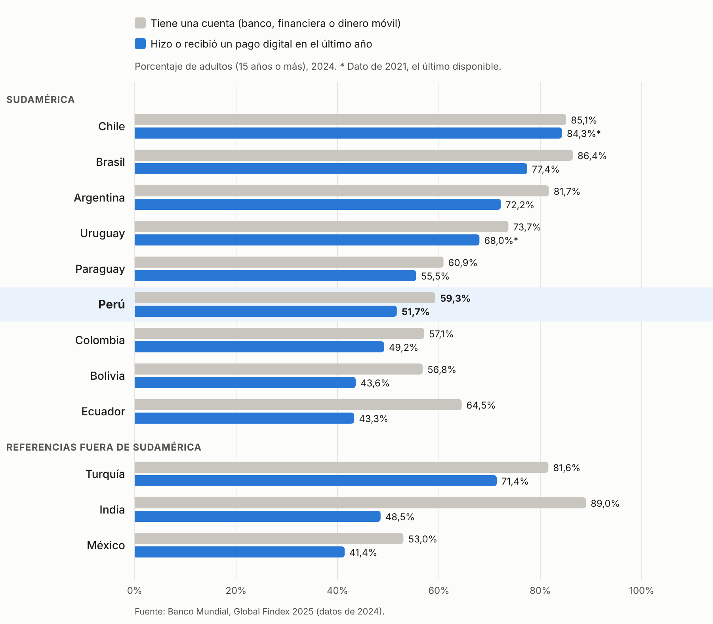

# Digitalización de los seguros en Sudamérica: dónde está Perú

Presentación en construcción · Láminas 1 a 3 y anexo · Noviembre de 2026

## Indicaciones generales de diseño

- **Formato:** 16:9. Una idea por lámina: el título es la conclusión, no el tema.
- **Jerarquía:** título de acción (1 línea, máximo 2) → cifras grandes → texto de apoyo breve → fuentes al pie en cuerpo pequeño.
- **Color:** Perú siempre en azul (#2A78D6); el resto de los países en gris (#9A978F o #C9C6BF); fondo claro (#FCFCFB). No usar otros colores para países, para que Perú se encuentre de un vistazo.
- **Tipografía:** sans serif de buena legibilidad. Cifras grandes en negrita (40-48 pt); texto de apoyo en 14-16 pt; fuentes en 10-11 pt.
- **Fuentes:** cada cifra lleva su fuente en el pie de la lámina, en formato (autor, año).

---

## Lámina 1 · Estado de la región

### Título en la lámina

**Sudamérica digitalizó sus pagos en una década; el seguro sigue sin despegar**

### Subtítulo

Seis o siete de cada diez adultos ya tienen una cuenta o hacen pagos digitales; el seguro sigue entre 1% y 3% del PBI y se vende sobre todo por personas.

### Layout sugerido

Tres columnas de igual ancho, cada una con un encabezado y tres cifras grandes con una línea de contexto. Debajo, una franja de ancho completo con la lectura. Pie de lámina con las fuentes.

```
┌─────────────────────────────────────────────────────────────────────────┐
│ TÍTULO DE ACCIÓN                                                        │
│ Subtítulo                                                               │
├───────────────────────┬───────────────────────┬─────────────────────────┤
│ SEGUROS               │ BANCA Y PAGOS         │ TECNOLOGÍA EN SEGUROS   │
│ [cifra] contexto      │ [cifra] contexto      │ [cifra] contexto        │
│ [cifra] contexto      │ [cifra] contexto      │ [cifra] contexto        │
│ [cifra] contexto      │ [cifra] contexto      │ [cifra] contexto        │
├───────────────────────┴───────────────────────┴─────────────────────────┤
│ LECTURA: la brecha entre la billetera y la póliza                       │
└─────────────────────────────────────────────────────────────────────────┘
  Fuentes
```

### Contenido de la lámina

**Columna 1 · Seguros: poco y vendido por personas**

| Cifra grande | Línea de contexto |
|---|---|
| **2,7% del PBI** | Penetración del seguro en América Latina sin las primas de pensiones (3,2% con ellas). En Sudamérica va de 1,2% en Paraguay a 2,8% en Chile; **Perú: 1,7%** |
| **US$ 78 a US$ 853** | Gasto en seguros por habitante, de Paraguay a Uruguay; **Perú: US$ 173** |
| **10% vs 20%** | Ventas de seguros por canales en línea en América Latina frente a Norteamérica y Europa (2021); corredores y agentes venden cerca de 65% |

**Columna 2 · Banca y pagos: el salto digital ya ocurrió**

| Cifra grande | Línea de contexto |
|---|---|
| **70% de los adultos** | Tiene cuenta en América Latina (39% en 2011); **Perú: 59%**. Brasil, Argentina y Chile superan 80% |
| **59% de los adultos** | Hizo o recibió un pago digital en 2024; **Perú: 52%**. El dinero móvil llega a 37% en la región y a **42% en Perú**, por encima del promedio |
| **43% tiene billetera** | En ocho países de la región (11% en 2021): Argentina 77%, Colombia 73%, **Perú 65%**. En Brasil, Pix supera los 160 millones de usuarios |

**Columna 3 · Tecnología en seguros: mucha adopción, poco negocio**

| Cifra grande | Línea de contexto |
|---|---|
| **80% / 84%** | En Brasil, 80% de las aseguradoras usa IA, pero 84% no espera más de 1% de ingresos adicionales por ella |
| **1%** | De las aseguradoras argentinas se define como «digital primero»; 73% de los ejecutivos cree que el seguro dentro de otras apps será relevante en cinco años |
| **67% vs 21%** | De los peruanos prefiere buscar y cotizar seguros en digital frente a los que compran su póliza en línea |

**Franja de lectura (ancho completo)**

> **La brecha está entre la billetera y la póliza.** La región ya paga en digital y Perú está por encima del promedio en dinero móvil, pero el seguro se sigue comprando poco y con una persona de por medio. Los medios de pago que permiten cobrar primas sin tarjeta ya operan en Brasil (Pix Automático) y Colombia (Bre-B), y llegan a Perú en 2027 (TAPP).

### Fuentes al pie

MAPFRE Economics (2025); McKinsey, citado por APESEG (2021); McKinsey (2025); Banco Mundial (2025), Global Findex; Forbes Chile (2026a); Credicorp e Ipsos, Índice de Inclusión Financiera 2025, citado por Forbes Chile (2025); CNseg (2026); EY y CIDeS, citados por iProUP (2026); APESEG (2023); Let's Money (2026); Vodanovic (2026).

### Notas del presentador

- Esta lámina responde «en qué terreno estamos». La idea es mostrar que la digitalización de la banca y los pagos ya pasó, mientras que la del seguro no.
- **Seguros.** Usamos la penetración sin pensiones porque es la que mide la compra voluntaria: con pensiones, Uruguay aparece en 3,6% del PBI; sin ellas, en 1,5%, por debajo de Perú.
- **Banca.** Perú está por debajo de la región en cuentas (59% frente a 70%) y en pagos digitales (52% frente a 59%), pero por encima en dinero móvil (42% frente a 37%): las billeteras le permitieron saltarse la cuenta bancaria tradicional. En el índice de inclusión financiera de Credicorp e Ipsos, Perú tiene 47 puntos, frente a 57,3 de Argentina, 56,7 de Chile, 49 de Ecuador y 45,4 de Colombia.
- **Crédito, si preguntan.** El crédito al sector privado es de cerca de 80% del PBI en Chile, 71% en Brasil, entre 35% y 40% en Perú y Colombia, y 11% en Argentina (Banco Mundial, citado por Forbes Chile, 2026b).
- **Tecnología en seguros.** Brasil y Argentina muestran el mismo patrón desde dos ángulos: mucha IA y muchos proyectos, pero casi nadie puede mostrar ingresos. En Perú, el cliente busca en digital pero compra con una persona.
- **Fuentes de banca.** Las cifras por país vienen directamente de la base del Global Findex 2025 del Banco Mundial; los promedios regionales (70%, 59% y 37%), de la reseña de Forbes Chile sobre el mismo informe. El índice de Credicorp e Ipsos no incluye Brasil, Uruguay ni Paraguay.

### Datos de respaldo por país

| País | Penetración total | Penetración sin pensiones | Gasto por habitante (US$) | Informalidad laboral | Tiene cuenta | Pago digital |
|---|---|---|---|---|---|---|
| Chile | 4,6% | 2,8% | 762 | 26,4% | 85,1% | 84,3%* |
| Uruguay | 3,6% | 1,5% | 853 | 32,7% | 73,7% | 68,0%* |
| Brasil | 3,3% | 3,3% | 338 | 35,6% | 86,4% | 77,4% |
| Colombia | 3,3% | 2,2% | 261 | 56,0% | 57,1% | 49,2% |
| Argentina | 3,0% | 2,3% | 418 | 52,8% | 81,7% | 72,2% |
| **Perú** | **2,0%** | **1,7%** | **173** | **70,5%** | **59,3%** | **51,7%** |
| Ecuador | 1,8% | 1,8% | 124 | 68,5% | 64,5% | 43,3% |
| Bolivia | 1,6% | 1,6% | 63 | 85,6% | 56,8% | 43,6% |
| Paraguay | 1,2% | 1,2% | 78 | 64,5% | 60,9% | 55,5% |
| América Latina | 3,2% | 2,7% | 341 | — | 70% | 59% |
| México (referencia) | 2,7% | 2,6% | 383 | 56,9% | 53,0% | 41,4% |

Fuentes: MAPFRE Economics (2025), datos de 2024; OIT, ILOSTAT (2026), último año disponible (2024 o 2025); Banco Mundial (2025), Global Findex, datos de 2024 (* 2021, el último disponible); promedios de América Latina en banca: Forbes Chile (2026a).

---

## Lámina 2 · ¿Dónde está Perú?

### Título en la lámina

**Perú está en el grupo de menor formalidad y menor compra voluntaria de seguros, junto a Ecuador, Paraguay y Bolivia**

### Subtítulo

Formalidad laboral frente a penetración voluntaria del seguro; el tamaño de cada burbuja es el gasto en seguros por habitante.

### Visual

Gráfico de cuadrantes: `cuadrantes.svg` (vector, para editar) o `cuadrantes.png` (imagen, para pegar directo).


- **Eje X:** formalidad laboral, porcentaje de trabajadores formales (100 menos la tasa de informalidad de ILOSTAT).
- **Eje Y:** penetración del seguro sin las primas ligadas a pensiones y riesgos laborales, % del PBI.
- **Tamaño de la burbuja:** gasto en seguros por habitante, en dólares.
- **Líneas de corte:** la mitad de los trabajadores formales (50%) y la penetración voluntaria promedio de América Latina (2,7% del PBI).
- **Color:** Perú en azul; los demás países de Sudamérica en gris; México con contorno punteado, solo como referencia.

### Layout sugerido

Gráfico a la izquierda, ocupando dos tercios del ancho. A la derecha, una columna con «Dónde está Perú» arriba y tres conclusiones numeradas debajo. Fuentes al pie.

```
┌──────────────────────────────────────────────┬──────────────────────────┐
│ TÍTULO DE ACCIÓN                             │                          │
│ Subtítulo                                    │                          │
├──────────────────────────────────────────────┼──────────────────────────┤
│                                              │ DÓNDE ESTÁ PERÚ          │
│         GRÁFICO DE CUADRANTES                │ 30% formal · 1,7% PBI    │
│         (2/3 del ancho)                      │ US$ 173 por habitante    │
│                                              │ 1. ...                   │
│                                              │ 2. ...                   │
│                                              │ 3. ...                   │
└──────────────────────────────────────────────┴──────────────────────────┘
  Fuentes
```

### Contenido de la columna derecha

**Dónde está Perú**

- **29,5%** de trabajadores formales: la segunda formalidad más baja de la región, después de Bolivia.
- **1,7% del PBI** en seguros voluntarios, por debajo del promedio de América Latina (2,7%).
- **US$ 173** por habitante en seguros, la mitad que el promedio regional (US$ 341).

**Tres conclusiones**

1. **Nadie es informal y muy asegurado.** El cuadrante superior izquierdo está vacío: en la región, la informalidad funciona como un techo para la compra voluntaria de seguros.
2. **Ser formal no basta.** Uruguay tiene 67% de formalidad y el mayor gasto por habitante, pero su compra voluntaria (1,5% del PBI) es menor que la de Perú. Solo Brasil y Chile combinan formalidad y compra voluntaria alta.
3. **Los países que más se parecen a Perú son Ecuador, Paraguay, Bolivia y Colombia.** Brasil, Uruguay y Chile son los más distintos, aunque son los que más casos digitales publican.

### Fuentes al pie

OIT, ILOSTAT (2026); MAPFRE Economics (2025), datos de 2024. Cálculo de cuadrantes y de parecido: elaboración propia.

### Notas del presentador

- **Por qué estos ejes.** Son dos indicadores verificados con la misma fuente para todos los países. La formalidad aproxima cuánta gente tiene un ingreso estable, un empleador y una cuenta; la penetración sin pensiones mide cuánto seguro se compra por decisión propia. La digitalización va en la lámina 3.
- **Cambio de fuente.** La informalidad ahora viene de la serie armonizada de ILOSTAT (último año, 2024 o 2025), en lugar de la nota de Bloomberg Línea con el Panorama Laboral de la OIT. Las dos series difieren (Uruguay, por ejemplo, 32,7% frente a 22,2%) porque miden con definiciones distintas; usamos ILOSTAT porque es la fuente primaria y permite comparar también con Turquía e India. Con ella, Argentina (47% de formalidad) pasa al lado informal del gráfico.
- **Cómo medimos el parecido con Perú.** Estandarizamos tres indicadores (informalidad, penetración sin pensiones y gasto por habitante) entre los diez países y medimos la distancia de cada uno a Perú. De más a menos parecido: Ecuador 0,27; Paraguay 0,94; Bolivia 0,96; Colombia 1,19; Argentina 1,68; México 1,82; Brasil 3,29; Uruguay 3,39; Chile 3,80.
- **Mensaje para cerrar.** Para Perú, los referentes estructurales son Ecuador, Paraguay, Bolivia y Colombia; los referentes de casos digitales son Brasil y Chile. Por eso conviene tomar de Brasil y Chile los mecanismos que se repiten en todas partes, como quitar pasos o resolver el siniestro rápido, y no sus resultados de mercado.

### Datos del gráfico

| País | Formalidad laboral | Penetración sin pensiones | Gasto por habitante (US$) | Cuadrante | Distancia a Perú |
|---|---|---|---|---|---|
| **Perú** | **29,5%** | **1,7%** | **173** | Informal, poco asegurado | — |
| Ecuador | 31,5% | 1,8% | 124 | Informal, poco asegurado | 0,27 |
| Paraguay | 35,5% | 1,2% | 78 | Informal, poco asegurado | 0,94 |
| Bolivia | 14,4% | 1,6% | 63 | Informal, poco asegurado | 0,96 |
| Colombia | 44,0% | 2,2% | 261 | Informal, poco asegurado | 1,19 |
| Argentina | 47,2% | 2,3% | 418 | Informal, poco asegurado | 1,68 |
| México (referencia) | 43,1% | 2,6% | 383 | Informal, poco asegurado | 1,82 |
| Brasil | 64,4% | 3,3% | 338 | Formal y asegurado | 3,29 |
| Uruguay | 67,3% | 1,5% | 853 | Formal, poco asegurado | 3,39 |
| Chile | 73,6% | 2,8% | 762 | Formal y asegurado | 3,80 |

---

## Lámina 3 · Digitalización financiera

### Título en la lámina

**Perú está a mitad de tabla en digitalización financiera: 6 de cada 10 adultos tienen cuenta y 5 de cada 10 pagan en digital**

### Subtítulo

Porcentaje de adultos con una cuenta y que hicieron o recibieron un pago digital en el último año, 2024.

### Visual

Gráfico de barras agrupadas: `digitalizacion.svg` (vector) o `digitalizacion.png` (imagen).



- **Dos barras por país:** gris, tiene una cuenta (banco, financiera o dinero móvil); azul, hizo o recibió un pago digital en el último año.
- **Orden:** de mayor a menor uso de pagos digitales dentro de Sudamérica; debajo, separadas, las referencias de fuera de la región (Turquía, India y México).
- **Perú:** fila resaltada con una banda azul clara y cifras en negrita.

### Layout sugerido

Gráfico a la izquierda, en tres cuartos del ancho. A la derecha, una columna con tres conclusiones. Fuentes al pie.

### Contenido de la columna derecha

**Tres conclusiones**

1. **La región va a dos velocidades.** Chile, Brasil, Argentina y Uruguay tienen 68% o más de adultos con pagos digitales; Perú, Colombia, Bolivia y Ecuador están entre 43% y 52%.
2. **Tener cuenta no es usarla.** En Ecuador, 64,5% tiene cuenta pero solo 43,3% paga en digital; en India, 89,0% frente a 48,5%. En Perú, la brecha es menor: 59,3% frente a 51,7%.
3. **Perú destaca en dinero móvil.** 42,5% de los adultos peruanos tiene una cuenta de dinero móvil, el tercer valor entre los países sudamericanos con dato, después de Brasil (58,2%) y Argentina (56,7%), por encima de Colombia (39,1%) y muy por encima de Ecuador (10,1%).

### Fuentes al pie

Banco Mundial (2025), Global Findex, datos de 2024; Chile y Uruguay, último dato de 2021.

### Notas del presentador

- **Qué mide.** El Global Findex encuesta a adultos de 15 años o más en cada país; «pago digital» incluye pagar o recibir con tarjeta, celular, transferencia o internet.
- **Chile y Uruguay** no tienen dato de pagos digitales en la edición 2025; se muestra el de 2021, marcado con asterisco. Su tenencia de cuenta sí es de 2024.
- **Lectura para el seguro.** El cobro digital de primas tiene una base parecida a la de Colombia o Paraguay: la mitad de los adultos peruanos ya paga en digital y 4 de cada 10 tienen dinero móvil. Lo que falta no es el canal de pago, sino que el seguro se ofrezca y se cobre ahí.
- **Dato relacionado.** El Findex también pregunta si la persona hace pagos regulares a una aseguradora: 10,2% en Perú, frente a 22,4% en Argentina, 13,9% en Brasil, 5,0% en Ecuador y 4,4% en Colombia.

### Datos del gráfico

| País | Tiene cuenta | Pago digital | Dinero móvil | Paga a una aseguradora |
|---|---|---|---|---|
| Chile | 85,1% | 84,3%* | s. d. | s. d. |
| Brasil | 86,4% | 77,4% | 58,2% | 13,9% |
| Argentina | 81,7% | 72,2% | 56,7% | 22,4% |
| Uruguay | 73,7% | 68,0%* | s. d. | s. d. |
| Paraguay | 60,9% | 55,5% | 35,9% | 8,0% |
| **Perú** | **59,3%** | **51,7%** | **42,5%** | **10,2%** |
| Colombia | 57,1% | 49,2% | 39,1% | 4,4% |
| Bolivia | 56,8% | 43,6% | 20,0% | 6,9% |
| Ecuador | 64,5% | 43,3% | 10,1% | 5,0% |
| Turquía (referencia) | 81,6% | 71,4% | 23,3% | 14,2% |
| India (referencia) | 89,0% | 48,5% | 23,1% | 10,0% |
| México (referencia) | 53,0% | 41,4% | 10,4% | 7,9% |

Fuente: Banco Mundial (2025), Global Findex, datos de 2024 (* 2021). s. d.: sin dato en la edición 2025.

---

## Anexo · ¿Sirven Turquía, India u otros países como referencia externa?

Para uso del equipo; no es una lámina.

### Tres miradas de parecido con Perú

Distancia a Perú calculada con indicadores estandarizados (cuanto más baja, más parecido).

| País | Estructura: informalidad (ILOSTAT) | Conducta financiera (9 indicadores Findex)¹ | Digitalización financiera (4 indicadores Findex)² |
|---|---|---|---|
| Ecuador | 68,5% | 0,50 | 0,95 |
| México | 56,9% | 0,56 | 0,94 |
| Colombia | 56,0% | 0,65 | 0,34 |
| Brasil | 35,6% | 0,70 | 1,39 |
| **Turquía** | **26,6%** | **0,74** | **1,15** |
| Argentina | 52,8% | 0,79 | 1,13 |
| Bolivia | 85,6% | 0,80 | 0,80 |
| Indonesia | 88,3% | 0,88 | 0,92 |
| **India** | **87,2%** | **0,95** | **0,74** |
| Tailandia | 63,2% | 1,13 | 1,09 |
| Paraguay | 64,5% | 1,20 | 0,39 |
| Vietnam | 67,0% | 1,33 | 0,80 |
| Filipinas | s. d. | 1,35 | 0,82 |
| Sudáfrica | 42,3% | 1,43 | 0,69 |
| Kenia | 86,5% (2019) | 1,59 | 1,88 |

Perú: informalidad de 70,5%. Penetración del seguro: Perú 2,0% (Moody's Local, 2025), Turquía 2,8% (Allianz Research, citado por Allianz Türkiye, 2025), India 3,7% (IRDAI, 2025).

¹ Ahorró dinero; ahorró en una institución o en dinero móvil; pidió prestado a familiares o amigos; pidió prestado por salud; su fuente principal para una emergencia sería la familia; o sus ahorros; su mayor preocupación son los gastos médicos; o el dinero para la vejez; hace pagos regulares a una aseguradora.
² Hizo o recibió un pago digital; tiene dinero móvil; pagó a un comercio en digital; pagó cuentas por celular o internet.

Fuentes: Banco Mundial (2025), Global Findex, datos de 2024; OIT, ILOSTAT (2026). Cálculo de distancias: elaboración propia, con los 20 países que tienen todos los datos de 2024.

---

## Referencias de las tres láminas y el anexo

- Allianz Türkiye (2025). *Allianz Küresel Sigorta Raporu 2025.* 2 de junio, sobre el Allianz Global Insurance Report 2025. https://www.allianz.com.tr/tr_TR/faaliyetlerimiz/bizden-haberler/allianz-kuresel-sigorta-raporu.html
- APESEG (2021). *Mitos y realidades en la distribución de seguros.* https://www.apeseg.org.pe/2021/09/distribucion-de-seguros-mitos-y-realidades/
- APESEG (2023). *Construyamos confianza: la apuesta del Insurance Day 2023.* https://www.apeseg.org.pe/2023/06/construyamos-confianza-la-apuesta-del-insurance-day-2023/
- Banco Mundial (2025). *The Global Findex Database 2025*, consultado en la API de datos del Banco Mundial (fuente 28 y WDI), noviembre de 2026. https://api.worldbank.org/v2/sources/28
- CNseg (2026). Estudio sobre IA en las aseguradoras brasileñas, reseñado por Revista Apólice. https://revistaapolice.com.br/2026/08/ia-avanca-nas-seguradoras-mas-retorno-ainda-e-incremental/
- Forbes Chile (2025). *Latinoamérica crece por quinto año en inclusión financiera, gracias a billeteras digitales.* 28 de octubre, sobre el Índice de Inclusión Financiera de Credicorp e Ipsos. https://forbes.cl/economia-y-finanzas/2025-10-28/latinoamerica-crece-por-quinto-ano-en-inclusion-financiera-gracias-a-billeteras-digitales/
- Forbes Chile (2026a). *Porvenir en la palma de la mano.* 4 de noviembre, con datos del Global Findex 2025. https://forbes.cl/contributors/2026-11-04/porvenir-en-la-palma-de-la-mano
- Forbes Chile (2026b). *Inclusión a crédito.* 4 de septiembre, con datos del Banco Mundial. https://forbes.cl/contributors/2026-09-04/inclusion-a-credito
- iProUP (2026). *El seguro embebido avanza en Argentina*, con el Radar Estratégico de EY Argentina y CIDeS. 11 de octubre. https://www.iproup.com/finanzas/72153-seguro-embebido-avanza-argentina-bancos-como-aprovecharlo
- IRDAI (2025). Informe anual 2024-25 del regulador de seguros de India, reseñado por Angel One. https://www.angelone.in/news/economy/life-insurance-penetration-falls-for-third-year-overall-insurance-coverage-stays-flat-in-fy25
- Let's Money (2026). *Pix Automático: 1 ano, R$ 1 bilhão por mês.* https://www.letsmoney.com.br/noticias/pix-automatico-1-ano-1-bilhao-mes/
- MAPFRE Economics (2025). *El mercado asegurador latinoamericano en 2024.* https://www.mapfre.com/media/MAPFRE-Economics_Mercado-Latam-2024_05.11.2025-REDUCIDO.pdf
- McKinsey & Company (2025). *Informe Global de Seguros 2025*, cifra tomada de la reseña de Diario Financiero. https://www.df.cl/mercados/seguros/america-latina-lidera-crecimiento-global-en-seguros-y-abre-espacio-para
- Moody's Local (2025). *Seguros en Latinoamérica: perspectivas 2026.* https://moodyslocal.com.gt/wp-content/uploads/2025/12/Research-Regional-Seguros-en-Latinoamerica-Perspectivas-2026-1.pdf
- OIT (2026). ILOSTAT, tasa de empleo informal (EMP_NIFL_SEX_RT), consultada en noviembre de 2026. https://ilostat.ilo.org/
- Vodanovic, L. (2026). *Nace TAPP para modernizar los pagos digitales en el Perú.* Gestión. https://gestion.pe/opinion/nace-tapp-para-modernizar-los-pagos-digitales-en-el-peru-por-ljubica-vodanovic-noticia/
